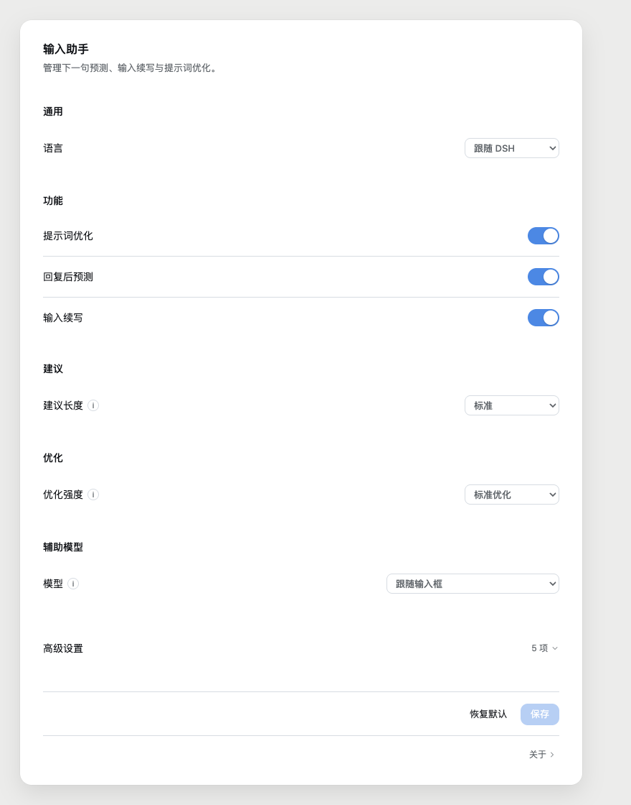
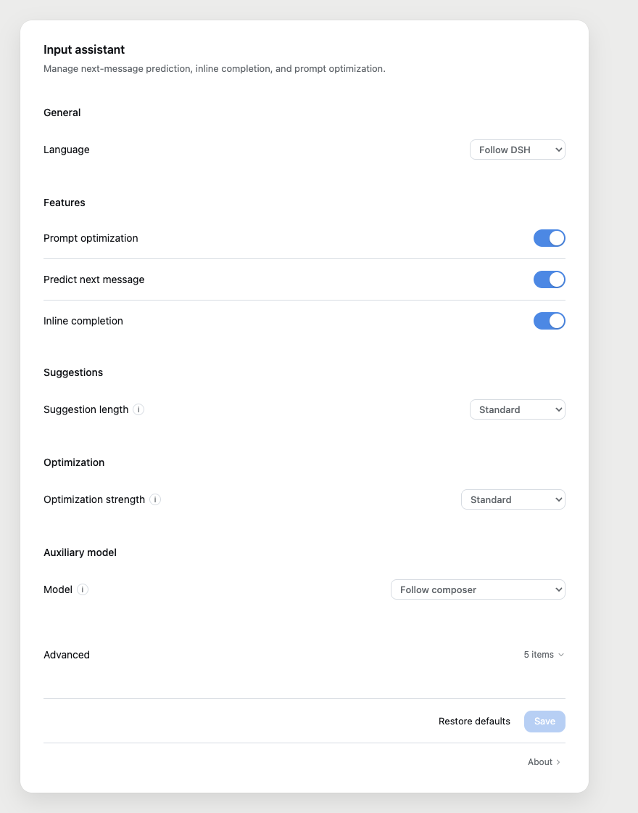

# DSH Composer Assistant

[简体中文](README.md) | English

Predict the next message, continue a draft, or polish a prompt in the DeepSeek Harness (DSH) composer. The plugin offers editable text only: press `Tab` to accept or `Esc` to dismiss. It never sends a message for you.

Current public release: [`dsh-composer-assistant@0.3.0`](https://www.npmjs.com/package/dsh-composer-assistant).

The English documentation is available in the GitHub source. The already-published `0.3.0` npm tarball predates this update and does not contain `README.en.md`; the repository package manifest now includes it for a future release.

## Features

| Feature | Behavior |
| --- | --- |
| Next-message prediction | After an assistant response, suggests what you might say next when the composer is empty |
| Draft completion | Suggests a suffix after you pause while drafting; it does not run when the caret is away from the end of the draft |
| Prompt optimization | Rewrites the full draft or selected text; review a diff, undo, copy the original, or ask for another version |

Inline ghost text is limited to the editor's visible area. Longer suggestions use a candidate card. Regenerating a suggestion for the same turn is not counted against the automatic-call limit, but may still incur model charges.

## Interface

| Chinese settings | English settings |
| --- | --- |
|  |  |

## Installation

Supported DSH range declared by the package: `>=0.2.1-rc.2 <0.3.0-0`. The package declares Node.js `>=22.19`; DSH Desktop normally provides its own runtime.

Run this command from a terminal where the DSH Desktop `dsh` command is available:

```shell
dsh plugin --profile desktop add dsh-composer-assistant@0.3.0
```

You can also install it from DSH's plugin manager. A normal install does not require a local build or a `.tgz` file. To install a locally built package from the repository:

```shell
pnpm install --frozen-lockfile
pnpm build
pnpm pack --pack-destination dist
dsh plugin --profile desktop add ./dist/dsh-composer-assistant-0.3.0.tgz
```

## Upgrade and rollback

To upgrade, replace the version in the command with the version you want, then fully quit and restart DSH:

```shell
dsh plugin --profile desktop add dsh-composer-assistant@0.3.0
```

DSH does not automatically update third-party plugins. Use DSH's plugin manager or install a specific version with the command above.

To roll back to a saved package archive:

```shell
dsh plugin --profile desktop add ./path/to/known-good.tgz
```

If an older version is available on npm, append `@version` to the package name to install it; do not copy a placeholder literally.

Keep a known-good `.tgz` before upgrading. When `0.3.0` was released, npm had no earlier stable release available for rollback; `0.0.0-stage` is a prerelease and is not recommended as a stable fallback.

## Use

| Action | Key |
| --- | --- |
| Accept a suggestion | `Tab` |
| Dismiss the current suggestion | `Esc` |
| Stop the current turn | Press `Esc` twice (existing DSH behavior) |

When a `/` command menu or `@` reference menu is open, DSH owns `Tab` and the plugin does not intercept it. The code suppresses requests while an IME composition is active, but actual IME and native keyboard behavior still needs validation on the target system.

The first time you open the composer, a short onboarding hint points to Optimize and Settings. Dismissing it with the button, `Esc`, or an outside click prevents it from appearing automatically again.

## Settings

| Group | Setting | Default | Details |
| --- | --- | --- | --- |
| General | Language | Follow DSH | Follow DSH, or force Chinese or English |
| Features | Prompt optimization, next-message prediction, draft completion | All enabled | Each feature can be disabled independently |
| Suggestions | Suggestion length | Standard | Short / Standard / Long |
| Optimization | Strength | Standard | Light / Standard / Deep |
| Auxiliary model | Model | Follow composer | Optionally choose a provider and model from the DSH catalog |
| Advanced | Conversation context limit | 16,000 characters | Caps the conversation text used in requests |
| Advanced | Suggestion timeout | 15 seconds | Configurable from 5 to 60 seconds |
| Advanced | Automatic calls per hour | 0 | Applies only to automatic prediction and completion; 0 means unlimited |
| Advanced | Temperature | 0.7 | Range 0–2; lower values are more stable |
| Advanced | Extra instruction | Empty | Appended to the system prompt; up to 500 characters |

Draft completion debounce is 600 ms, the minimum interval between automatic requests is 2 seconds, and the draft limit is 8,000 characters. These fixed values are not exposed in Settings.

**Unsaved settings are retained.** When the settings component unmounts with changes still in the form, the plugin writes that settings form to `sessionStorage` for the current browser tab. Reopening Settings in the same tab restores the unsaved changes when they still differ from the saved DSH settings, and shows a notice. A successful save or explicit reload clears the stored form. “Restore defaults” changes the form only; press Save to persist it to DSH.

## Model costs and privacy

- Prediction, completion, and optimization call models through DSH's LLM interface. The relevant draft or selection and the conversation text context needed for generation are sent to the model provider configured in DSH; processing is not local-only.
- By default, the plugin follows the model selected in the composer. If you choose an auxiliary model, calls use that provider and model. Charges and data handling follow your DSH configuration and the provider's policies.
- The hourly limit counts automatic prediction and completion only. Manual optimization and “Regenerate” are explicit user actions and are not counted. A limit of `0` leaves automatic calls unlimited, so it is not a cap on total model costs.
- The plugin never sends or submits a suggestion automatically. You decide whether to accept and send it.
- The plugin uses DSH host services and its LLM interface; this repository does not configure a separate plugin-operated model API or analytics service. Data handling by DSH and model providers is outside the plugin's control.
- Saved settings live in DSH plugin storage. Unsaved **settings form values** are temporarily stored in the current tab's `sessionStorage`; this is separate from the composer draft.

## Verification scope and known limitations

The package metadata declares DSH compatibility as `>=0.2.1-rc.2 <0.3.0-0` and explicitly lists compatibility records for `0.2.1-rc.3` and `0.2.1-rc.5`. Automated tests, browser fixtures, and an isolated npm install do not establish full compatibility with a live DSH Desktop environment.

Post-release audit on 2026-11-03: the npm 0.3.0 tarball's SRI matched registry metadata. A clean consumer project installed it successfully on Node.js 24.22.1 / npm 11.9.0, and the host entry imported. Repository typecheck, build, package verification, and publish checks passed; 159 automated tests passed outside the browser-theme suite. The full test run could not start that browser suite because neither Edge nor Chrome was installed. This audit did not run the plugin in a live DSH Desktop window.

- Ghost text is limited to the visible editor area; longer suggestions use a candidate card.
- While `/` or `@` menus are open, `Tab` belongs to the DSH menu.
- Version 0.3.0 is not claimed to have passed every real Edge window, Chinese IME, native `@` menu, candidate-card positioning, undo, or focus interaction. These need case-by-case validation with the target DSH, operating system, and input method.
- Automated browser fixtures use local substitutes and do not call paid models. They test plugin logic, not model quality or every native host interaction.

## Development checks

The repository requires Node.js `>=22.19` and pins pnpm `11.28.5`:

```shell
pnpm install --frozen-lockfile
pnpm typecheck
pnpm test
pnpm build
pnpm pack:release
pnpm test:web
pnpm publish:check
```

## License

MIT. This project is modified from [Somnus678/dsh-input-assistant](https://github.com/Somnus678/dsh-input-assistant), retaining the upstream MIT license and copyright notice. New contributions are also released under MIT. This fork: [Mr-Elk/dsh-composer-assistant](https://github.com/Mr-Elk/dsh-composer-assistant).
