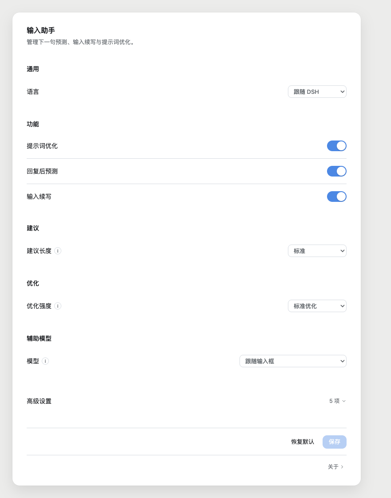
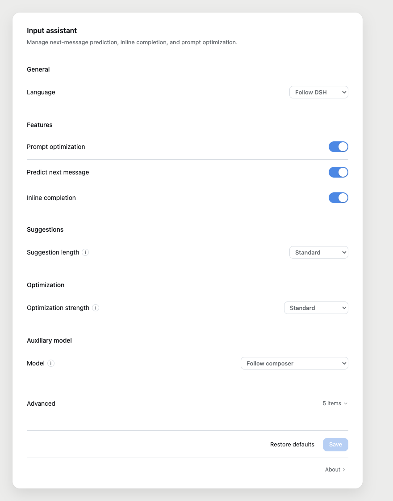

# DSH 输入助手

在 DeepSeek Harness 的输入框里，帮你想下一句。

不是自动回复，也不是替你发送。它只在输入框里给建议：`Tab` 采纳，`Esc` 忽略，最后发什么仍由你决定。


## 0.3.0 的变化

- **中文 / English 切换**：可跟随 DSH，也可固定中文或 English；提示、报错和设置页一起切换。
- **错误码化**：配置校验、浏览器兜底异常和宿主错误都有对应文案，不再中英混排。
- **设置页重做**：通用 / 功能 / 建议 / 优化 / 辅助模型 / 高级；保存条只在有改动时可用。
- **开关重画**：44 × 24 SVG 轨道，20px 正圆；不再依赖 input 伪元素。
- **反馈更轻**：保存和恢复用标题区 toast；错误固定在保存条上方。
- **齿轮弹窗更清楚**：标题旁 `i` 展开两行说明，不再用悬浮提示遮住开关。
- **草稿恢复**：关掉设置再打开，未保存的修改会恢复并提示。

## 三个功能

| 功能 | 它会做什么 |
| --- | --- |
| 下一句预测 | 助手回复结束后，在空输入框里给出你下一句最可能说的话 |
| 输入续写 | 根据当前草稿和光标位置继续写；长建议放不下时改用浮动候选卡 |
| 提示词优化 | 把草稿或选中文字改写成可发送的表达；可看 diff、一次性撤销、复制原文 |

不满意可以「换一条」；同一轮内重试，不消耗新的轮次。

## 界面

| 中文设置页 | English |
| --- | --- |
|  |  |

设置页按分组展示；输入框旁只放 `✦ 优化` 和 `⚙`。保护选中、查看改动、撤销、复制原文、换一条这些一次性动作在输入区就地出现，不塞进设置弹窗。

## 安装

要求 DSH `>=0.2.1-rc.2 <0.3.0-0`，当前在 `0.2.1-rc.5` 上验证。

```shell
# npm 包发布后可用
dsh plugin --profile desktop add dsh-composer-assistant
```

发布前从本地压缩包安装：

```shell
dsh plugin --profile desktop add ./dist/dsh-composer-assistant-0.3.0.tgz
```

更新或回滚：

```shell
dsh plugin --profile desktop remove dsh-composer-assistant
dsh plugin --profile desktop add <包或版本>
```

更新后重启 DSH。DSH 没有第三方插件自动更新；升级走侧边栏「插件」页，或上面的命令。

## 使用

| 动作 | 按键 |
| --- | --- |
| 采纳建议 | `Tab` |
| 忽略建议 | `Esc` |
| 停止当前轮次 | 连按两次 `Esc`（DSH 原有行为，不受影响） |

`/` 命令菜单或 `@` 引用菜单打开时，`Tab` 归菜单所有，插件不会抢键。中文输入法组字期间不发请求。

第一次打开输入框会出现一次入门提示，指向优化和齿轮；点“知道了”、`Esc` 或点外面关闭，之后不再出现。

## 设置

| 分组 | 项 | 默认 | 说明 |
| --- | --- | --- | --- |
| 通用 | 语言 | 跟随 DSH | 跟随 DSH / 中文 / English |
| 功能 | 提示词优化 / 回复后预测 / 输入续写 | 开 | 三个功能独立开关 |
| 建议 | 建议长度 | 标准 | 短 / 标准 / 长，内部映射为字符上限 |
| 优化 | 优化强度 | 标准 | 轻度润色 / 标准优化 / 深度梳理 |
| 辅助模型 | 模型 | 跟随输入框 | 从 DSH 模型列表选；辅助调用单独计费 |
| 高级 | 上下文上限 | 16000 | 参与建议的对话上下文字数 |
| 高级 | 建议超时 | 15 秒 | 5–60 秒，慢模型可放宽 |
| 高级 | 每小时调用上限 | 0 | 只计自动建议；0 不限制 |
| 高级 | 温度 | 0.7 | 0.3 稳定 / 0.7 平衡 / 1.0 发散 |
| 高级 | 额外指令 | 空 | 追加到系统提示词，≤500 字 |

固定参数不暴露：续写防抖 600ms、最小请求间隔 2s、草稿上限 8000 字、改写增长上限 3×。

保存行为：

- 设置页和齿轮弹窗共用同一份草稿，只提交改动字段。
- 没有改动时保存置灰；取消或点外面丢弃未保存改动。
- 点“恢复默认”只重置表单，再点“保存”才写入。
- 保存成功显示标题区 toast；错误显示在保存条上方。
- 关掉设置再打开，未保存的修改会恢复并提示。

## 费用和隐私

- 预测、续写和优化都只调用 DSH 已配置的模型；不另外上传草稿。
- 如果选了固定辅助模型，这部分调用按该模型单独计费。
- 插件不自动发送消息，不修改你的 DSH 模型配置。
- 测试和浏览器夹具使用本地替身，不消耗付费 token。

## 已知限制

- 灰字只能画在输入框可见区域内；更长的建议走候选卡。
- `Tab` 在 `/`、`@` 菜单打开时归菜单所有。
- 中文输入法组字期间不发请求；真实 IME 行为依赖系统和输入法。
- 真实 Edge 窗口、真实 `@` 菜单和真实候选卡仍属于验收缺口；当前以 Chrome 和 DSH 桌面端验证为主。
- 仓库若在 exFAT 卷上遇到 pnpm 报错，可用 `./scripts/local-dev.sh` 同步到 APFS 临时目录构建。

## 开发

```shell
pnpm typecheck
pnpm test
pnpm build
pnpm test:package
node scripts/smoke-web.mjs
```

当前：17 个测试文件、163 条测试通过；Chrome 冒烟 0 次付费调用。

## 许可

MIT。本项目基于 [`dsh-input-assistant`](https://github.com/Somnus678/dsh-input-assistant)（作者 Somnus678 与贡献者）修改，保留原 MIT 许可与版权声明；新增部分同样以 MIT 发布。

本 fork：[`Mr-Elk/dsh-input-assistant`](https://github.com/Mr-Elk/dsh-input-assistant)
